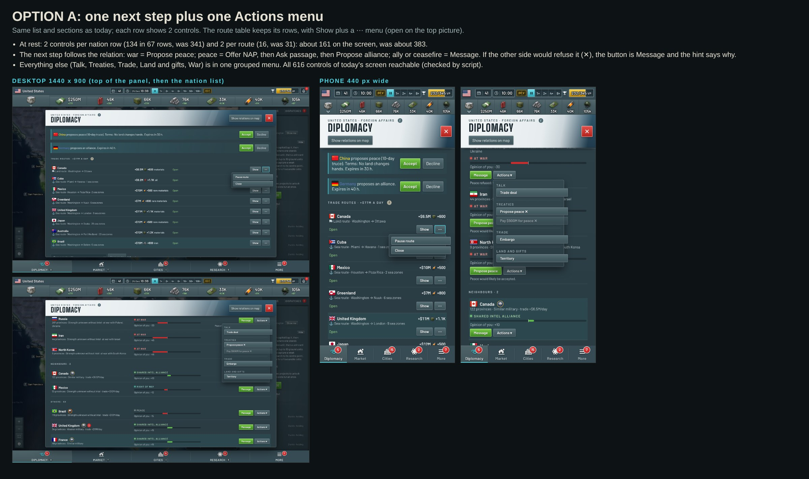

# Diplomacy: layout options (owner point 14, 2026-11-25)

Status: proposal only. No game code changed. The mockups are scratch copies of the test page with the Diplomacy panel replaced by option A, B or C; they use the game's own styles, buttons and the real state (US, day 41, 68-nation world: 3 wars, 6 allies in one coalition plus a second coalition, 8 trade routes, one with an independent partner (Greenland), 2 offers waiting, an embargo, a ceasefire, captured land).

**Sheets** (each: the top of the panel with offers, trade routes and coalitions, then the nation list with a menu or card open; desktop 1440 x 900 at 2x, phone 440 px at 3x):

- `docs/diplomacy-options/0-today.jpg`
- `docs/diplomacy-options/option-A.jpg`
- `docs/diplomacy-options/option-B.jpg`
- `docs/diplomacy-options/option-C.jpg`

Related, on `auto-test/fixes` (read only, nothing repeated here): B2.22 (phone: the "More" menu opens off the left edge and cuts off Declare war, passage, alliance, route and Embargo; visible on master in `0-today.jpg`) and IMP-17 (opening Diplomacy takes about 1.5 s on an older phone, and `blocs()` writes state while drawing). Decisions that bear on this screen: ECO-13 (gifts only inside a bloc), DIP-4 (embargo is a real rule), DIP-5 (territory sales). None is changed by any option.

## Recommendation

**Build A now, with the phone menu fix (B2.22) and the nations at peace without a border folded into one block; keep B as the follow-up.** A and B share the next-step rule and the grouped action list, so A grows into B (B's card is A's menu laid open). C is the weakest: it keeps the long list and adds a second menu.

## Counts (the test state, counted the same way for every layout)

"At rest" = controls you can see and press without opening anything (buttons, lists, and the menus' own buttons; not what is inside a closed menu). Checked by script on the real page.

| | Today | A | B | C |
|---|---|---|---|---|
| Per nation row at rest | 5 to 6 | 2 | 1 | 3 |
| The 67 nation rows at rest | 341 | 134 | 67 (16 shown, the other 51 at peace folded) | 201 |
| Trade routes at rest (8 routes) | 31 | 16 | 8 chips | 8 chips |
| Whole screen at rest | about 383 | about 161 | about 43 plus the open nation card (8 to 12) | about 218 |
| Every control of today's screen reachable | (616) | all | all | all |

The reachability check compares every control of today's screen (all 67 nation rows, the offers' Accept and Decline, every route's Show, Escort, Pause and Close, "Open a route with" and Open route, the coalition name box, Rename and Leave, the header buttons) with what each option offers, opening every nation card in B.

## Today: what the screen offers (`diploHTML` in `index.html`, `tradeHTML`, `nationHTML`)

Header: Show/Hide relations on map, close (X), Back to the map.

Offers on top (per offer): treaty or trade proposal: Accept, Decline; territory offer: Accept, Counter..., Decline; a line for each declaration of war on you.

Trade routes (table, up to 8 routes): per route Show, Escort (sea routes), Pause route / Resume, Close = 3 to 4 buttons (31 for the 8 routes in the test state); Open a route with... (list) + Open route; chips for closed routes with a reopen button.

Coalitions: Rename, Leave coalition (and a name box); founding one needs an alliance.

Per nation (one row each, 67 rows). Not every button shows every time; this is the full set:

| Group | Buttons | Shown when |
|---|---|---|
| Talk | Message, Trade deal | always |
| Treaties | Propose peace, Pay $X for peace (tribute) | at war |
| | Offer NAP | peace, ceasefire |
| | Ask passage | peace, NAP |
| | Propose alliance | not allied |
| | Declare war | not at war, not in ceasefire |
| Trade | Open trade route / Close trade route | not at war |
| | Embargo / Join embargo / Lift embargo | always |
| Land and gifts | Territory | you hold captured land, or the nation is a person's seat, or an offer is open |
| | Give | same coalition |
| | Gift $50M | allied or same coalition |

Behind the nation window (Message / Trade deal / Territory / Give tabs): six quick messages and Send; the deal grid (resources both ways, treaties as tick boxes) with Send proposal and Clear; province rows with Show on map, Offer to sell/buy, Cancel, Withdraw; the coalition gift form. These stay as they are in all three options (they are the "second level" already).

## Option A: one next step plus one Actions menu (`option-A.jpg`)

Same list and sections. Each row shows 2 controls: a next-step button chosen from the relation and `Actions ▾`, a menu in labelled groups (Talk, Treaties, Trade, Land and gifts, War). The route table keeps its rows: Show plus a `⋯` menu (Escort, Pause, Close), opening inside the screen on a phone.
- Pro: smallest change, same places, same habits; the nation window and everything else untouched; easy to build (one function).
- Con: still a long list of 67 rows; a menu is one more tap for Message and Trade deal on non-allies.

## Option B: relation-first list, one button per row, nation card (`option-B.jpg`)

List grouped by relation (At war, Allies and coalition, Treaties and ceasefire, At peace neighbours, then the rest folded). A row has the name, relation, opinion and ONE button (the same next step as A). Tapping the row opens the nation's card: every action in labelled groups, no menus (desktop: a pane on the right; phone: the card opens under the row). The route table becomes one row of chips; **every chip opens its own route card** (Show, Escort, Pause, Close), so a route whose partner is not a nation row (an independent partner: Greenland in the test state; every nation has 1 or 2) keeps its buttons; a nation partner's route also appears in that nation's card. Coalitions fold into one line.
- Pro: the calmest screen; fits the real order of play (who am I at war with, who are my friends); the card is the natural place for the opinion reasons, the likely-answer line and the route.
- Con: most work (new list, card, selection state, phone accordion, route cards); every uncommon action costs a tap on the row first; changes where trade routes live.

## Option C: a card per nation, three labelled buttons (`option-C.jpg`)

Cards in a grid (one column on a phone), war cards edged red. Each card: name, relation, opinion bar, the likely-answer line, then three buttons: Message, `Treaties & war ▾` (peace, NAP, passage, alliance, tribute, Declare war) and `Trade & gifts ▾` (route and its Show / Escort / Pause / Close, embargo, trade deal, Territory, Give, Gift). Routes become chips that open their route card, as in B.
- Pro: no hidden "More"; the menu names say what is inside; the opinion bar and the answer are visible without hover.
- Con: cards are taller than rows (about 2 cards per screen on a phone); 67 cards need the relation grouping and a fold to be usable; two menus where A has one.

## Rules shared by A and B

- **The next step:** war: Propose peace; peace: Offer NAP; NAP: Ask passage; passage: Propose alliance; ally or ceasefire: Message.
- **When the next step would be refused** (today's ✕, e.g. Russia, who thinks it is winning): the row's button becomes Message, and the hint line under the row says why ("Peace refused: they think they are winning (opinion −30)"). The refused step stays in the menu or card, greyed with its ✕ as today. A dead main button is never shown.
- **Declare war** is only in the menu or card, as a red item in its own War group.
- **A trade route lost to war** (the rebels plan, docs/REBELS-PLAN.md section 5, trade options B and C): a dimmed row "Lost: Germany (war)" at the end of the route table in A, a dimmed chip in B and C, opening the same line (what it cost, what frees the slot).

## Limits of the mockups

Menus are native `details` elements; the next-step rule is only the one above; the unread badge and hints are the real ones. Not drawn: keyboard use, the territory and give tabs (unchanged), the lost-route chip. Nothing here is tested for speed (IMP-17 is a separate fix on `auto-test/fixes`). The mockup scripts are kept outside the repository (scratch); the sheets above are the record.

## Questions for the owner (suggested answers)

1. Which option should be built? **A now, B later.**
2. The next-step ladder above, with Message when the step would be refused? **Yes.**
3. Declare war only inside the menu or card, never the main button? **Yes, a red item in the War group.**
4. Fold the nations at peace without a border into one block by default? **Yes.**
5. Build it with the phone menu fix (B2.22) and IMP-17 in one Diplomacy pass? **Yes.**
