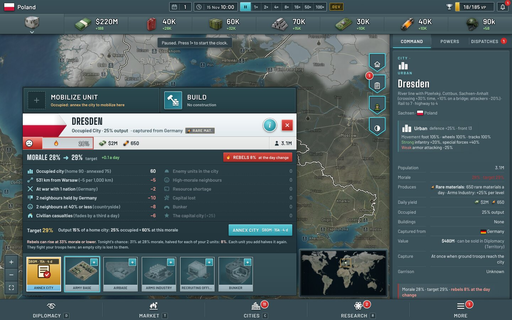
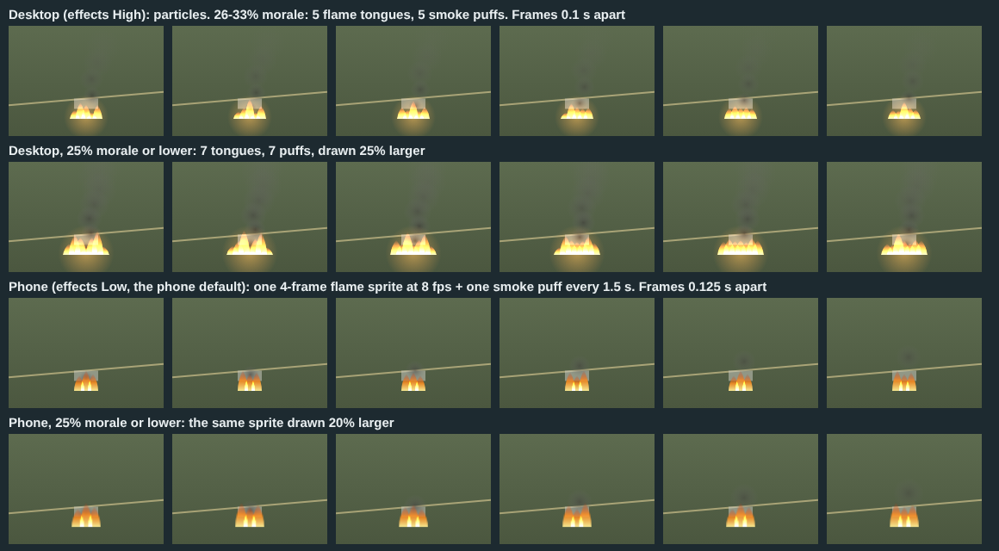

# Occupation, morale, annexing and rebels: the plan (owner points 8-11, 2026-11-25)

This is a plan only. Nothing in the game has changed yet. It replaces the earlier version of this file (owner rules 18 and 19): today's
**unrest**, the earlier plan's **daily per-unit changes**, **integration** and **Pacify** are gone, as the owner asked. What stays from the
earlier plan is listed in section 4.6. The owner's numbers are used exactly as given. Where the owner asked for a proposal, or where his words
can be read two ways, the options are set out with a recommendation in bold and worked numbers. The questions at the end each have a
suggested answer.

Every number below was measured on the real rules (nations world, seed 12345 unless stated) with read-only scripts that lay this plan over an
in-memory copy of the rules (`docs/rebels-plan/sim/`, Appendix B says how to rerun them). No game file was changed.

## 0. The three proposals you asked for

### 0.1 (a) Annex City: cost and build time

Annex City is built from the city's build list like a building. It uses the city's one construction slot, so nothing else is built there
while it runs. The cost grows with the city's size, in the same four size bands the rebels use (section 4.3).

What annexing is worth: a city's full output (a home city at 100% morale, no Arms Industry) is about $28M a day for a town or an ordinary
city, $29M for a large city and $37M for a metropolis (money plus its main resource at the world base price), and 2.5k to 7.4k manpower.
Occupied at 50% morale it gives 18% of that; annexed at 65% morale (its target is 15 higher) it gives 40%. The gain is therefore about
$6M a day for a town or a city, $6.4M for a large city and $8.2M for a metropolis, plus 0.6k to 1.6k manpower a day.

| City size (people) | Cities on the map | **B (recommended)** money · manpower · time | B pays back its money in | and its manpower in | A (light), payback | C (steep), payback |
|---|---|---|---|---|---|---|
| Town (under 1.5 million) | 208 | **$50M · 10k · 3 days** | 8 days | 18 days | $30M · 5k · 2 d (5 / 9 days) | $90M · 15k · 4 d (15 / 27 days) |
| City (1.5 to 5 million) | 295 | **$80M · 15k · 4 days** | 13 days | 21 days | $45M · 8k · 3 d (7 / 11) | $140M · 25k · 5 d (23 / 35) |
| Large city (5 to 20 million) | 148 | **$120M · 25k · 5 days** | 19 days | 25 days | $70M · 12k · 4 d (11 / 12) | $210M · 40k · 6 d (33 / 40) |
| Metropolis (20 million or more) | 33 | **$180M · 40k · 6 days** | 22 days | 24 days | $110M · 20k · 5 d (13 / 12) | $320M · 60k · 7 d (39 / 37) |

(The payback counts from the day the annexing ends; the build time comes on top. A nation's own multipliers, its catch-up and its
administration, move these figures by up to a third either way.)

**Recommendation: B.** It is a high cost, as you asked: a typical nation (the middle of the 68) earns about $190M a day after upkeep
($220M before it; the range after upkeep is $182M to $221M) and 58k manpower a day, and holds about $220M and 90k at the start. So annexing
an ordinary city costs about two fifths of a day's money and a quarter of a day's manpower, and a metropolis nearly a whole day's money and
two thirds of a day's manpower. It pays back in two to three weeks, about the length of a war, so it is a real choice: annex the cities you mean to keep, not
every village. A is cheap enough to annex everything at once; C pays back only after a month or more, so few would bother.

Worked example (section 5's 30-day run): Poland takes Dresden, Hamburg and Nürnberg (cities) and Munich (a large city) from Germany.
Annexing all four under B costs $360M and 70k manpower. Section 5 shows what they give, occupied and annexed.

### 0.2 (b) How "distance to the capital" is measured

The modifier is −5 per unit of distance, rounded. Four ways to measure it were checked on the real map, from each nation's capital to its own
cities and to foreign cities it might occupy:

- **Straight-line distance in kilometres** (great circle), 1 unit = 1,000 km. The same for every nation, easy to show ("531 km from
  Warsaw"), costs nothing to work out, does not change during the game.
- Straight-line distance, 1 unit = 1,500 km. Softer.
- March time of an infantry unit along roads, rail and by sea, 1 unit = 2 days. Rewards railways, but an island next to the capital counts as
  far (Belfast from London −15, Hobart from Canberra −15), it changes when a road is bombed or the weather turns, and it is hard to explain.
- Province hops or map hexes. Rejected: provinces are far smaller in Europe than in Siberia, and hexes are stretched near the poles (the
  map's projection doubles distances at 60° north), so both would punish some nations for the way the map is drawn.

**Recommendation: straight-line kilometres, −5 per 1,000 km (rounded).** Rounding: 0 to 499 km is 0, 500 to 1,499 km is −5, 1,500 to
2,499 km −10, and so on.

**One addition that departs from your numbers (question 2): a limit of −30, distance counted up to 6,000 km.** Your rule has no limit.
Without one, a city on another continent can never be held: Washington to Baghdad is 9,907 km, −50, an occupied target of 10%, risings every
night whatever you do. With the limit, Baghdad held by the United States has an occupied target of 30% and an annexed one of 45%: hard, but
possible with troops and annexing. The limit changes only cities 6,500 km or more from their capital (in the tables below: Cayenne −30 instead of −35,
Baghdad −30 instead of −50; Vladivostok, at 6,449 km, is −30 either way).

Real cities of the nations world (homeland base target 90 before any other modifier):

| Nation | City | km from capital | **1,000 km** (with the −30 limit) | 1,500 km | 2 days' march (march hours) |
|---|---|---|---|---|---|
| Russia | Saint Petersburg | 683 | **−5** | 0 | 0 (20 h) |
| Russia | Kazan | 792 | **−5** | −5 | 0 (18 h) |
| Russia | Yekaterinburg | 1,464 | **−5** | −5 | −5 (36 h) |
| Russia | Novosibirsk | 2,816 | **−15** | −10 | −10 (78 h) |
| Russia | Irkutsk | 4,225 | **−20** | −15 | −10 (111 h) |
| Russia | Vladivostok | 6,449 | **−30** | −20 | −20 (182 h) |
| United States | New York | 250 | **0** | 0 | 0 (7 h) |
| United States | Chicago | 1,044 | **−5** | −5 | 0 (18 h) |
| United States | Dallas | 1,967 | **−10** | −5 | −5 (33 h) |
| United States | Los Angeles | 3,693 | **−20** | −10 | −5 (65 h) |
| United States | Seattle | 3,793 | **−20** | −15 | −10 (74 h) |
| United States | Anchorage | 5,396 | **−25** | −20 | −40 (378 h, by sea) |
| China | Shanghai | 921 | **−5** | −5 | 0 (20 h) |
| China | Guangzhou | 1,874 | **−10** | −5 | −5 (32 h) |
| China | Kashgar | 3,493 | **−15** | −10 | −10 (100 h) |
| France | Lyon | 355 | **0** | 0 | 0 (7 h) |
| France | Marseille | 676 | **−5** | 0 | 0 (15 h) |
| France | Cayenne (French Guiana) | 7,236 | **−35** (−30) | −25 | −60 (588 h, by sea) |
| Brazil | Manaus | 1,904 | **−10** | −5 | −10 (78 h) |
| Canada | Vancouver | 3,436 | **−15** | −10 | −10 (73 h) |
| Australia | Perth | 2,961 | **−15** | −10 | −5 (56 h) |
| Australia | Hobart | 771 | **−5** | −5 | −15 (161 h, by sea) |
| India | Chennai | 1,738 | **−10** | −5 | −5 (30 h) |
| Indonesia | Jayapura | 3,656 | **−20** | −10 | −30 (267 h, by sea) |
| United Kingdom | Edinburgh | 562 | **−5** | 0 | 0 (11 h) |
| United Kingdom | Belfast | 557 | **−5** | 0 | −15 (152 h, by sea) |
| Germany | Cologne | 448 | **0** | 0 | 0 (10 h) |
| Japan | Sapporo | 969 | **−5** | −5 | −5 (58 h) |
| Chile | Punta Arenas | 2,185 | **−10** | −5 | −10 (82 h) |

Cities you might occupy (occupied base 60, annexed base 75):

| Holder | City | km | **1,000 km** (with the −30 limit) | Occupied target before other modifiers | Annexed |
|---|---|---|---|---|---|
| Poland | Dresden | 531 | **−5** | 55 | 70 |
| Germany | Paris | 876 | **−5** | 55 | 70 |
| Russia | Kyiv | 700 | **−5** | 55 | 70 |
| Russia | Berlin | 1,563 | **−10** | 50 | 65 |
| United States | Havana | 1,881 | **−10** | 50 | 65 |
| China | Hanoi | 2,286 | **−10** | 50 | 65 |
| Brazil | Buenos Aires | 2,425 | **−10** | 50 | 65 |
| United States | Baghdad | 9,907 | **−50** (−30) | 10 (30) | 25 (45) |

The distance is to the nation's capital of the moment: if the capital falls and moves (rules/state.js checkNation), distances are measured
from the new one.

### 0.3 (c) How much troops in a city lower the rebel chance

The chance itself (section 4.2) rises from 0% at 33% morale to 50% at 25%. "Troops" are your ground units standing in the city (not aircraft
or ships, not units marching through). Three ways were compared, together with what happens when the rebels then fight. The fights were
measured with the real battle rules: rebels against a garrison with your +25% dug-in city bonus, 8 cities per match-up
(`docs/rebels-plan/sim/duel.js`):

| Garrison against rebels | 1 v 3 | 2 v 3 | 3 v 3 | 2 v 4 | 3 v 4 | 4 v 4 | 3 v 5 | 4 v 5 | 5 v 5 | 4 v 6 | 6 v 6 |
|---|---|---|---|---|---|---|---|---|---|---|---|
| Garrison wins | 0/8 | 3/8 | **8/8** | 0/8 | 2/8 | **8/8** | 0/8 | 1/8 | **8/8** | 0/8 | **8/8** |
| Length of the fight | 27 h | 68 h | 69 h | 40 h | 83 h | 73 h | 52 h | 102 h | 82 h | 69 h | 75 h |

So a garrison at least as large as the rebel band always wins (in about three days: rebels never lose battle morale, decision CMB-9), and
a smaller one almost always loses, after which the city is empty and goes over to the rebels.

The chance that night for an ordinary city (a band of 4 rebels), at 28% morale (31%) / 20% (67%) / 10% (100%), in %:

| Your units in the city | 0 | 1 | 2 | 3 | 4 | 5 | 6 |
|---|---|---|---|---|---|---|---|
| **H: each unit halves the chance (recommended)** | 31 / 67 / 100 | 16 / 33 / 50 | 8 / 17 / 25 | 4 / 8 / 13 | 2 / 4 / 6 | 1 / 2 / 3 | 0.5 / 1 / 1.6 |
| S: a garrison as large as the band stops risings (chance × (1 − units ÷ band)) | 31 / 67 / 100 | 23 / 50 / 75 | 16 / 33 / 50 | 8 / 17 / 25 | 0 | 0 | 0 |
| P: −15 points per unit | 31 / 67 / 100 | 16 / 52 / 85 | 1 / 37 / 70 | 0 / 22 / 55 | 0 / 7 / 40 | 0 / 0 / 25 | 0 / 0 / 10 |

**Recommendation: H, each of your ground units in the city halves the chance.** It is one sentence the player can remember, every unit
counts, and it never quite reaches zero, so risings still happen in a garrisoned city now and then. When they do, a garrison as large as
the band holds the city (8 of 8), which is the picture you described: "rebels attack them, the city stays mine". Under S a rising can only
happen when the garrison is smaller than the band, so almost every rising ends with the city lost; under P one or two units wipe out the
risk at middling morale and do little at very low morale.

The city sheet mockup (section 6.1) shows rule H: Dresden at 28% morale with 2 units, 31% halved twice, 8% that night.

What H means over ten nights in an ordinary city held at 20% morale: no troops, 67% a night, so the city is almost surely lost within two
nights; 2 units, a rising about every 6 nights, which they lose (2 v 4: 0 of 8); 4 units, a rising in about one ten-night stretch in
three, which they win; 6 units, about one chance in ten of a rising at all.

### 0.4 Where this plan departs from your words, and the settled decisions it changes

Your numbers are copied as given. These are the places where the plan adds to them or has to choose a reading; each has a question:

| Your words | The plan | Why | Question |
|---|---|---|---|
| Distance: −5 per unit of distance | −5 per 1,000 km **with a limit of −30** (added) | without it a city on another continent can never be held (section 0.2) | 2 |
| A liberated homeland city or province drops to 55% | 55%, always; land of your homeland handed back by a peace treaty counts as liberated | the earlier draft kept a higher morale ("or its morale, if higher"): dropped, your number stands | 3 |
| Low-morale neighbours: −7 each for a city, −4 each for a countryside province (and +3 / +1) | read as the **neighbour's** type; the other reading (the province's own type) is set out with numbers | the words fit both | 8 |
| Wars: −2 per nation, rebels included | rebels count as one more war **while rebels stand in one of your cities**; the other reading: always one more war | the words fit both | 9 |
| The chance "higher below" 25% | 100% at 10% morale (a proposal, section 4.2) | not given | 1 |
| Resource shortage "up to −50", civilian casualties "up to −30" | how each is counted (sections 2.4, 2.5) | not given | 1 |
| (not asked) | **occupied land counts a quarter and annexed land a half against the administration factor** (section 5.4) | without it conquest by a small nation never pays, so point 11's "holding and annexing pays off" cannot hold; **the trade results of section 5 depend on it** | 17 |
| (not asked) | a trade route lost to war leaves its slot empty (section 5) | today a lost route is replaced the next day, so occupying a partner costs nothing | 15 |

Settled decisions (docs/DECISIONS.md on `auto-test/fixes`) this plan changes or touches:

| Id | Today | After this plan |
|---|---|---|
| **REB-1** | build the earlier REBELS-PLAN with its suggested answers: occupied cities only, countryside morale floored at 50%, certain risings below 30% after a 3-day grace and a 5-day cooldown, +3% a day per garrison unit, integration after 10 good days, Pacify, and your change "one level-1 infantry unit left in the captured city beats any rebels; an empty city still flips" | **replaced** by points 8-10: morale toward a target, Annex City, a nightly roll from 33%, each unit halves the chance, rebels fight in a real battle (one infantry unit no longer wins by rule). Kept: rebel sizes 3/4/5/6, the badge, the 3D squad, an empty city lost |
| **REB-2** | the old partisan rule runs on master; the `rebels` branch waits for your OK to merge | the branch is **not merged**; the parts listed in section 9 are copied onto the REBELS branch from master, the rest is dropped |
| **REB-3** | after a capital falls: occupied cities only rebel (option A now); "no homeland rebels" | **superseded if question 10 is answered yes**: any city at 33% or lower can rebel, and the capital-lost −20 can bring homeland cities there. If you keep REB-3, only occupied cities roll |
| **NAV-4** | trade routes form automatically from economy and distance | still automatic, but under options B and C (section 5) a slot lost to war stays empty while the war lasts or the partner's cities are held unannexed |
| **DIP-5** | territory sales: only captured land; the land bought becomes the buyer's homeland | sales unchanged; if question 5 is answered yes, land bought, ceded or given arrives **annexed** (50%, morale base 75), not homeland, unless it was the receiver's homeland |
| CMB-9 | rebels never lose battle morale | unchanged, used in section 0.3 |
| MOB-1 | one rule (`canMobilize`) decides who may mobilize where | unchanged: "occupied: annex the city to mobilize here" is one more reason inside that rule (`mobBlock`), for the page and the AI alike |
| CMB-6 | a province is captured the hour a ground force reaches its heart with no defenders | unchanged; capture now also sets morale to 25% and removes the annexed status |

## 1. The rules in a few lines

- **Every city and countryside province has a morale**, 70% at the start of a game. It moves once a day, at the day change, an eighth of the
  way toward a **target**: the base for what the place is (home city 90, annexed city 75, occupied city 60, countryside 100) plus or minus
  the modifiers in section 2.3. The city panel lists them all.
- **Output** follows morale as it does today (45% at 0 morale, 100% at full morale), times **25% in an occupied city or province** and
  **50% in an annexed one**. An occupied city cannot mobilize units.
- **Annex City** (from the city's build list) turns an occupied city into an annexed one: 50% output, a morale base of 75, and it can
  mobilize. Capture takes the status away.
- **A city at 33% morale or lower burns** (fire and smoke on the map) and can rebel. Once a day, at the day change, it rolls: 0% at 33%,
  50% at 25%, more below; each of your ground units in the city halves the chance. Rebels fight any troops in the city (yours count as dug
  in: +25%); an empty city goes over to them at once. The countryside never rebels.
- **Occupying a trade partner costs you that trade** (its slot stays empty) for as long as the war lasts or you hold its cities
  unannexed, and while you hold them unannexed your other routes pay 25% less (section 5).
- **Occupied land counts a quarter, annexed land a half, against a nation's administration factor**, so that holding and annexing pay
  off (section 5.4). This is not in your list; without it the trade results of section 5 do not hold (question 17).

## 2. Morale (point 9)

### 2.1 Starting values and the daily step

| When | Morale |
|---|---|
| Start of a game, every city and countryside province | 70% |
| A city or province is captured from another country, or from independent land | 25% |
| A city or province of your own homeland is taken back (liberated), or handed back to you by a peace treaty | 55% |
| A nation's land passes to the nation that destroyed it (rules/state.js checkNation) | 25% (it is occupied land) |

At every day change, after the day's output is paid: **morale = morale + (target − morale) ÷ 8**. Morale is kept to one decimal, but
everything the player sees and every threshold (33%, 40%, 100%) uses the whole number shown. Example: a city captured at 25% with a target
of 55 shows 29%, 32%, 35%, 37%, 40%, 42% on the following days: it leaves the danger zone on day 3 and reaches 50% after about two weeks.

### 2.2 Base targets

| Province | Base target |
|---|---|
| A city of your homeland (its home nation, `S.home`, is you) | 90 |
| An annexed city | 75 |
| An occupied city | 60 |
| Any countryside province (homeland, annexed or occupied) | 100 |

The countryside always aims at 100 before modifiers, as you wrote, but an occupied one still gives only 25% of its output (section 3.4).

### 2.3 Modifiers on the target

All are added to the base, and the target is then kept between 0 and 100.

| Modifier | Value | How it is counted |
|---|---|---|
| Distance to the capital | −5 per 1,000 km, rounded, at most −30 | proposal (b), section 0.2. The capital city itself: 0 km |
| Wars | −2 per nation you are at war with, at most −25 | Nations with 0 VP (no land left) do not count. **Rebels count as one more war** while rebels stand in any city you hold (question 9: or always, −2 on every province from the start). Independent land is not a nation and does not count |
| Enemy neighbours | −5 per adjacent province held by a nation you are at war with | land neighbours only (a sea zone is not a neighbour); independent land does not count (question 6) |
| Enemy units in the province | −1 | any force of a nation you are at war with, or rebels, standing in the province (not marching through, not aircraft). As written: −1 whatever their number (question 7) |
| Low-morale neighbours | −7 for each such neighbour that is a city, −4 for each that is countryside | your own adjacent provinces showing 40% or less, as they stood before today's step (question 8) |
| High-morale neighbours | +3 for each such neighbour that is a city, +1 for each that is countryside | your own adjacent provinces showing 100% |
| Resource shortage | up to −50 | section 2.4 |
| Civilian casualties | up to −30, shrinking by a third each day | section 2.5 |
| Capital lost | −20 on every province you hold | while your original capital (the one you started with) is held by another nation |
| The capital city | +25 | your capital of the moment (a new capital after a move counts) |
| Bunker | +5 / +10 / +20 / +35 / +50 at levels 1-5 | the working level (a knocked-out bunker gives nothing). The garrison's own morale bonus (`BUNKER_LV.mrl`, +33% at level 4) is a different thing and stays as it is |

Worked examples (peace unless stated):

| Province | Base | Distance | Other | Target | Output at that morale |
|---|---|---|---|---|---|
| Warsaw, Poland's capital, Bunker I | 90 | 0 | capital +25, Bunker +5 | 100 (120 kept to 100) | 100% |
| Vladivostok, Russian homeland city | 90 | −30 | | 60 | 78% |
| Los Angeles, the United States at war with 2 nations | 90 | −20 | wars −4 | 66 | 81% |
| Dresden, occupied by Poland the day after capture: 2 German provinces next door, 2 of its neighbours just taken (25%), a battle there the day before | 60 | −5 | war −2, enemy neighbours −10, low-morale neighbours −8, casualties −6 | 29 | 25% × 61% = 15% |
| Dresden two weeks on (the front has moved on, its neighbours have recovered) | 60 | −5 | war −2 | 53 | 25% × 74% = 18% |
| Dresden annexed | 75 | −5 | war −2 | 68 | 50% × 82% = 41% |

**The neighbour rule read the other way (question 8).** The plan reads "−7 each for a city, −4 each for a countryside province" by what the
*neighbour* is. Read by what the *province itself* is, a city would pay −7 for every low-morale neighbour (and gain +3 for every one at
100%) and a countryside province −4 (and +1). Dresden the day after capture has 2 low-morale countryside neighbours: −8 under the plan's
reading (target 29%; morale stays at 28%, rebels 8% that night with 2 units), −14 under the other (target 23%; morale falls to 27%,
rebels 9% that night, and more each night after). The other reading makes cities on a fresh front much harder to hold; the plan's makes a burning city
weigh on its whole region, which is the more natural picture.

### 2.4 Resource shortage (up to −50): proposal

A resource counts as short on a day when your stock of it ran out and your production of it is negative (the existing `N.short` flag,
rules/tick.js daily). In practice that is money (unpaid upkeep), oil, iron and electronics, the four things upkeep uses; materials, rare
materials and manpower are never used up by upkeep. The modifier applies to every province you hold.

- **Recommended: by depth.** For each short resource, −50 × the share of that day's need left unmet, at least −5; added up, at most −50.
  Oil need 60 a day and production 40 with an empty tank: a third unmet, −17. No iron at all against an iron upkeep: −50 on its own. A
  nation short of a trickle of electronics: −5.
- Flat: −10 per short resource, at most −50.
- Slow: −5 per day while any resource is short, up to −50, falling back 10 a day once supplied.

By depth makes a small slip cheap and a real collapse severe, and its line is easy to read ("Oil: a third of your needs unmet −17").

### 2.5 Civilian casualties (up to −30): proposal

**Source (recommended): the province's own war damage.** Today every battle step, ranged fire, air raid and missile that hits a province adds
war damage there (rules/economy.js warDamage): 2 an hour while a battle goes on, a ballistic missile 22, a cruise missile 12, a Heavy Bomber
6 per bomber on a city. Each point of war damage adds half a point of civilian casualties to that province: a full day of fighting adds 24, a
ballistic missile 11, a cruise missile 6, a raid by three Heavy Bombers 9. The total is capped at 30 and **shrinks by a third at each day
change** (×2/3): 24, 16, 11, 7, 5, 3. Today war damage lowers morale directly and heals 2.5 a day; under this plan it acts only through this
modifier. (It still kills people as today, and the Bunker still spares them.)

Other ways considered: from the share of the province's people killed (the same events, harder to read); nation-wide (every province pays
for losses anywhere, which punishes a big country for a battle on its edge).

Order at the day change: the morale step first (it uses the day's casualties), then the casualties shrink by a third. Because morale moves
an eighth of the gap a day, the effect on morale itself is small and slow: a −24 hit (a day of fighting) lowers the city's morale by 3 points
the next day and by about 6 at most, on the fourth day, then it recovers; −30 (the limit) by about 7 at most; a ballistic missile (−11) by
about 3. Casualties tip a city that is already near 33% over the line; they do not make a calm city rebel.

### 2.6 Morale and output (kept as today)

Output = base yield × **(0.45 + 0.55 × morale ÷ 100)** (today's link, rules/economy.js provYield) × **1 for homeland, 0.5 annexed, 0.25
occupied** (this replaces `occFactor`, today a ramp from 25% to 100% over 10 days) × the blockade and convoy factors as today.

One thing must change with it. The nations world sets each nation's catch-up multiplier (`N.boost`, rules/state.js tierStart) from its
income at hour 0. With every province at 70% at the start, that income is 16% lower than today's, so the multiplier comes out too high,
and once morale settles near 90 every economy ends 11-12% richer than its tier is meant to be (measured: world income on day 60 is $17.0
billion a day under the plan against $15.2 billion today, both seeds; section 7.2). **The calibration must use each province's peacetime target** (the
morale it will settle at), not the starting 70%. Population still grows only above 70% morale (rules/tick.js), unchanged.

### 2.7 What is removed

- Unrest (`S.unrest`, `unrestDay`, `unrestOf`) and the partisans it spawned; integration (`S.integ`); the per-unit daily change; Pacify (the
  button and the $40M order: question 11); war damage as a direct cut to morale.
- Mobilisation's strain on the home front (today up to 15 unrest per Mobilisation level in homeland provinces): it is not in your list, so
  it goes; question 12 offers to keep it as one more modifier.
- The agent's "Incite unrest" (+35 unrest today) becomes **"Incite revolt": −20 morale at once** in an occupied city (question 13).

## 3. Occupied, annexed, homeland (point 8)

### 3.1 What each status means

| Status | Output | Morale base (city) | Mobilize units | Changes by |
|---|---|---|---|---|
| Homeland | 100% | 90 | yes | capture (it is then occupied for the captor) |
| Annexed | 50% | 75 | yes | capture (the status is lost) |
| Occupied | 25% | 60 | **no** ("Occupied: annex the city to mobilize here") | Annex City |

Buildings may still be built in an occupied city (Annex City is one of them). The countryside's base is 100 whatever its status.

### 3.2 Annex City

- **Where:** in the city's build list, first card, only while the city is occupied by you ("Annex City · $80M · 15k · 4 d").
- **Cost and time:** proposal (a), section 0.1. Paid when it starts, like a building.
- **When:** any time, even while the city burns, while rebels are in it, or while it is under attack, as you said. It needs the city's
  construction slot to be free (one construction at a time, as for every building).
- **When it ends:** the city is annexed: output 50%, morale base 75 (morale itself then climbs toward the new target an eighth a day; it does
  not jump), and units can be mobilized there.
- **If the city is captured** (by an enemy, or retaken by its original owner), an annexing in progress is lost with its cost, and an
  annexed city loses the status: for the new holder it is occupied (25% morale, or 55% if it is that nation's own homeland).
- **Rebels:** if your troops are in the city when rebels rise, they fight (your troops count as dug in: +25%), the city stays yours and the
  annexing carries on. If the city is empty, or your troops there are all destroyed or retreat, the rebels take the city at once: you lose
  it, the annexing and its cost.
- **The countryside around an annexed city:** question 4 (suggested: annexing a city also annexes the occupied countryside provinces whose
  nearest city it is, so a conquered region can be brought to 50% without a second kind of order).
- **Land you receive by treaty, sale or gift:** question 5 (suggested: it arrives annexed, not homeland, unless it was your homeland).

### 3.3 Rules and API

`annexCity(n, p)` and `annexWhy(n, p)` in rules/api.js (the page and the AI use one checked order). The construction is
`S.cons[p] = {k:'annex', lvl:1, h, h0}`; when it ends `S.anx[p] = n` (annexed by n). Capture deletes `S.anx[p]` and clears `S.cons[p]`
(capture already clears it). `mobBlock` (rules/production.js) refuses units in an occupied city with the reason above.

### 3.4 The countryside

The countryside never rebels. Occupied countryside starts at 25% morale and aims at 100 minus its modifiers, so it recovers within a week or
two once the front moves on (in the 60-day world runs, occupied countryside averaged about 90% morale by day 30), but it keeps giving 25%
unless question 4's suggestion is taken.

## 4. Rebels (point 10)

### 4.1 Which cities

Any city you hold whose morale shows 33% or lower: homeland, annexed or occupied (your point 10 says "a city"; the earlier plan allowed only
occupied cities, and settled decision REB-3 keeps homeland cities from rebelling after a capital falls: question 10 checks this). Not the countryside. Not while rebels are already in the city.

### 4.2 The chance each night: the curve below 25%

At every day change, after the morale step, each such city rolls once. From 33% to 25% the chance rises by 6.25 points per point of morale
(your numbers: 0% at 33%, 50% at 25%). Below 25%, three ways were considered (chance in %, before troops):

| Morale | 33 | 32 | 31 | 30 | 29 | 28 | 27 | 26 | 25 | 22 | 20 | 17 | 15 | 12 | 10 or less |
|---|---|---|---|---|---|---|---|---|---|---|---|---|---|---|---|
| **Recommended: 100% at 10%** | 0 | 6 | 13 | 19 | 25 | 31 | 38 | 44 | 50 | **60** | **67** | **77** | **83** | **93** | **100** |
| Same slope: 100% at 17% | 0 | 6 | 13 | 19 | 25 | 31 | 38 | 44 | 50 | 69 | 81 | 100 | 100 | 100 | 100 |
| Gentle: 100% at 0% | 0 | 6 | 13 | 19 | 25 | 31 | 38 | 44 | 50 | 56 | 60 | 66 | 70 | 76 | 80 (100 at 0) |

**Recommended: 100% at 10%** (a straight line from 50% at 25% to 100% at 10%: 3.33 points per point of morale, about half the slope
above 25%, which is 6.25; certain at 10% and below). A city that low has been neglected
for days; a certain rising there is fair, and the troop rule still lets a garrison keep the real chance small: at 10% morale, 4 units bring
it to 6%.

### 4.3 The rising

- **Size:** 3 rebel infantry in a town (under 1.5 million people), 4 in a city, 5 in a large city (5 million or more), 6 in a metropolis
  (20 million or more), as in the earlier plan.
- **Your troops in the city:** a real battle, by the ordinary battle rules. Your forces there count as dug in for it (+25% in a city, the
  owner's `DIG_CITY`) even if they arrived less than 12 hours ago, and keep the holder's defence and the Bunker as usual. Rebels never lose
  battle morale (decision CMB-9), so they fight to the last. The city stays yours throughout, and an annexing carries on.
- **No troops in the city** (or yours are destroyed or retreat): the rebels take it at once. It goes back to its original country if that
  country still exists and is not you (the rebels become its troops, at least 2 infantry); otherwise it becomes independent and the rebels
  stay as its garrison. A homeland city that rebels becomes independent. You take it back with an ordinary attack. (The earlier plan's
  24 hours alone in the city before it flipped is dropped: question 14.)
- **What is lost with the city:** as on a capture: the production queue, any construction (an annexing too), one Bunker level; air wings
  based there escape to the nearest airbase or are lost (the rebels branch's `wingsFlee`).
- **After a rising** morale does not change, and the city cannot rise again while rebels are in it. A city whose rebels were crushed keeps
  its morale, so if it is still low it can rise again the next night.
- **Wars modifier:** while rebels stand in any of your cities, they count as one more war (−2 on every province; question 9).

### 4.4 Rebels as their own side (kept from the earlier plan)

Rebels belong to no nation (owner −1, flagged `rebel`), are at war with everyone, never move, and are named "Rebels". Their badge has the
grey band with **crossed rifles**; on the map they are the 3D rebel squad (irregular fighters, no helmets, AK-pattern rifles, one rocket
launcher), shown at the same zoom as every other force. A seat always identifies rebels standing in a city it holds.

### 4.5 What the computer does about it

Section 7.

### 4.6 What stays from the earlier plan, and what goes

Stays: rebel sizes 3/4/5/6; where a lost city goes; rebels never move and never lose battle morale; the badge, the name, the 3D squad and
their zoom; air wings escaping; buildings staying with a Bunker level lost; the computer's self-brake; old partisans becoming rebels.
Goes: unrest and its daily rates, integration, Pacify, the 3-day grace and 5-day cooldown, certain risings below 30%, "one infantry unit
crushes any rebels" (replaced by the real fight you asked for), the 24-hour hold, the countryside floored at 50% morale.

## 5. Occupying a trade partner (point 11)

### 5.1 What happens today (measured)

A trade route ends when its two nations go to war (rules/trade.js `trInvalid`, at the next daily pass). But the slot it leaves is filled
again the next day by another partner (`tradeGen`), so the attacker trades as much as before within a day. The run: Poland (4 routes, $31.7M
a day plus goods) declares war on Germany on day 2, Germany being its land-route partner ($5.8M and 1.3k materials a day), and takes 4 German
cities (Dresden, Hamburg, Nürnberg, Munich) with the countryside around them on days 3 and 6, leaving 6 infantry in each; Germany's computer
turn is switched off so the cities stay taken. Poland has 4 routes again on day 3, and its trade over the 30 days is worth $1,561M when
Germany was a partner against $1,558M when it was not. **Today, occupying a trade partner costs nothing that can be seen.**

### 5.2 Options

- **A. Today's rule.** No difference (above).
- **B. "That trade is lost".** The route ends at war, as today, and **its slot stays empty** while you are at war with that nation or hold
  any of its cities you have not annexed. It is free again after peace once those cities are annexed or handed back. The same holds for
  the other side. The trade panel shows the empty slot: "Lost: Germany (war) · −$5.8M and 1.3k materials a day".
- **C. B, plus a trade shock (recommended).** While you hold any city of a former partner that you have not annexed, your other routes pay
  25% less ("your partners are wary of you"). Annexing those cities ends the shock (peace is not needed for that); the lost slot still
  waits for peace.

### 5.3 Thirty days, measured (Poland and Germany, the run above)

Value = money plus goods at the day's market price. "War alone" is the same war with nothing taken. All runs use section 2's morale and the
administration weighting of 5.4.

| Day (seed 12345) | 1 | 3 | 7 | 14 | 30 | 30-day total |
|---|---|---|---|---|---|---|
| Trade, money a day: non-partner (any option), $M | 31.6 | 32.4 | 33.6 | 33.7 | 34.5 | value $1,558M |
| Trade: partner, option A | 31.7 | 32.4 | 33.7 | 33.8 | 34.5 | $1,561M |
| Trade: partner, option B | 31.7 | **25.4** | 26.3 | 26.4 | 26.9 | **$1,205M (−$353M)** |
| Trade: partner, option C | 31.7 | **19.0** | 19.7 | 19.8 | 20.2 | **$926M (−$632M)** |
| The 4 taken cities, occupied, value a day $M | 0 | 16.6 | 24.9 | 25.1 | 28.3 | $703M |
| The 4 taken cities, annexed at capture (B costs: $360M, 70k), value a day $M | 0 | 16.6 | 41.1 | 53.5 | 62.6 | $1,426M |
| Their morale on day 30, occupied / annexed | | | | | | 45, 42, 32, 40 / 66, 57, 51, 60 |

What Poland's whole economy (gross value over the 30 days, before upkeep) gets from the conquest, against the same war with nothing taken
(about $17,500M). Three seeds (12345 / 777 / 99), because the rest of the world moves the totals by about $100M from run to run:

| | Non-partner | Partner, A (today) | Partner, B | **Partner, C** |
|---|---|---|---|---|
| Hold the 4 cities, occupied, seed 12345 / 777 / 99 | +$185M / +$297M / +$244M | +$304M / +$234M / +$95M | −$157M / −$243M / −$53M | **−$436M / −$560M / −$384M** |
| Average of the three | **+$242M** | +$211M | −$151M | **−$460M** |
| Partner against non-partner, same seed (average) | | −$31M (−$149M to +$119M: noise) | −$393M | **−$702M** |
| Trade alone over 30 days, the three seeds | $1,558M to $1,561M | $1,533M to $1,561M | $1,182M to $1,205M | $908M to $926M |
| Annex them at once, seed 12345 (gross: the $360M and 70k manpower of the annexing are paid out of it) | **+$669M** | | +$439M | about +$380M (the shock ends when the last annexing finishes, day 10) |

So under C a war on a non-partner pays from the first weeks (about +$240M in a month while holding the cities occupied), while the same
conquest of a trading partner costs Poland about $460M in a month unless it annexes, $700M worse than the non-partner case, and its trade
income drops from $34M to $20M a day in every seed: **clearly noticeable**, on the trade panel and in the treasury. Annexing (or not
occupying the partner at all) is the way out, which is the story you described: the occupied cities stay weak until morale recovers, and
holding and annexing them pays off. Under B the difference is a bit over half of C's ($390M); under today's rule (A) there is none: the
partner and non-partner runs differ only by the run-to-run noise, and their trade is the same.

**Recommendation: C.** If you want only the literal "I lose that trade", take B.

### 5.4 Needed for "holding pays off": administration

Today a nation's income is multiplied by an administration factor, `80 ÷ (40 + provinces)` kept between 0.6 and 1.6 (rules/economy.js
income0), and every province counts, occupied or not. Poland starts with 17 provinces (factor 1.40); taking the 4 cities and the 7 countryside
provinces around them drops it to 1.18, a 16% cut on everything Poland makes, far more than the occupied land gives at 25%. Measured
over the same 30 days: holding the 4 cities costs Poland $1,661M against the war alone, and annexing them still costs $930M. With the rule
as it stands, conquest by a small nation never pays.

**Recommended: occupied provinces count a quarter in the administration count and annexed ones a half** (as much as they produce). Then
Poland's factor goes from 1.40 to 1.34 only, and the table in 5.3 holds (question 17). **Every figure in 5.3 uses this weighting**: if
question 17 is answered no, conquest costs Poland money under every trade option, partner or not.

### 5.5 Rules

`S.trade.lost[key] = {a, b, h}` is written when a route ends because of war (`trEnded`); `tradeGen` leaves one slot free for each live
entry; an entry ends at peace once neither side holds unannexed cities of the other. Option C: `tradeIncome` multiplies the routes of a
nation holding such cities by 0.75. Dispatch when the route ends: "Your trade route with Germany ended: war broke out. Its slot stays empty
while you are at war with Germany or hold its cities without annexing them; holding them also costs you 25% on your other routes."

**Where the lost route shows.** Today: one dimmed row at the end of the route table, "Lost: Germany (war) · −$5.8M and 1.3k materials a
day", with the reason and what frees it on hover or tap. In the Diplomacy redesign (docs/DIPLOMACY-OPTIONS.md): option A keeps the route
table, so the same row; options B and C fold the routes into chips, so the lost route is a dimmed chip "Lost: Germany" that opens the same
line. Whichever Diplomacy option is built, the REBELS build adds this row or chip.

## 6. What the player sees

### 6.1 The city panel: the morale factors list

Mockups (the real page with the proposed parts drawn into it; Poland holding Dresden, taken from Germany, with 2 infantry there):

- Today: `docs/rebels-plan/sheet-today-desk.jpg`, `docs/rebels-plan/sheet-today-phone.jpg`
- Plan: `docs/rebels-plan/sheet-plan-desk.jpg`, `docs/rebels-plan/sheet-plan-phone.jpg`

Top to bottom, inside the city sheet under its stat row:

1. **The stat row's morale chip** keeps its bar and face and shows the whole-number morale; at 33% or lower it adds a small flame and a
   red outline. Tapping it opens or closes the factors list (open by default for an occupied city or one at 40% or less; the choice is
   remembered on the device).
2. **Header:** "MORALE 28% ➜ 29% target", the daily move ("+0.1 a day", green up, red down) and, when the city can rebel, a red chip with
   a flame: "REBELS 8% at the day change" (the chance after the troop rule: 31% at 28% morale, halved for each of the 2 units).
3. **Factors**, one row each: an icon, what it is in plain words with its count ("2 neighbours held by Germany", "531 km from Warsaw
   (−5 per 1,000 km)", "Civilian casualties (fades by a third a day)"), and the value on the right, red when negative, green when
   positive. The base comes first ("Occupied city (home 90 · annexed 75) 60"). Desktop: two columns, with the factors at 0 listed dimmed so
   the player learns what exists. Phone: one column, only the factors that are not 0.
4. **Footer:** "Target 29%", the output line "Output 15% of a home city: 25% occupied × 60% at this morale", and the **Annex City**
   button with its price and time (occupied cities only; while it runs it shows a bar and the days left, as the Build button does).
5. **A note in plain words** when the city can rebel: "Rebels can rise at 33% morale or lower. Tonight's chance: 31% at 28% morale,
   halved for each of your 2 units: 8%. Each unit you add halves it again. They fight your troops here; an empty city is lost to them."

Also: the banner's status line reads "Occupied City · 25% output" or "Annexed City · 50% output"; MOBILIZE UNIT in an occupied city reads
"Occupied: annex the city to mobilize here"; the **Annex City** card leads the build cards (gold, with its price and time on it). The side
panel (province details) shows "Morale 28% · target 29% · rebels 8% at the day change" in place of today's unrest bar. The Cities list shows the flame chip on every city
that can rebel, and its Morale sort puts them first.

### 6.2 The fire and smoke on the map

Mockups: `docs/rebels-plan/fire-map-desk.jpg` and `docs/rebels-plan/fire-map-phone.jpg` (one still frame over Dresden) and
`docs/rebels-plan/fire-frames.png` (six frames of each look).

- **When:** on every city showing 33% morale or lower that the viewer can see (its own cities always; others where the fog allows:
  question 16). It fades in over 1 second when the city reaches 33% and goes out over 2 seconds when it rises above. It is display only:
  it never touches the rules or their dice.
- **Look:** flame tongues over the city's centre (additive, a white-yellow core to orange to a dark-red tip, each flickering at its own 6 to
  10 Hz), a soft orange glow on the ground, and a column of smoke puffs rising and drifting with the display wind the battle smoke already
  uses (fx.js `windX`/`windY`), dark at the base and greying as they rise, lit orange from below at night. At 26-33% morale: 5 tongues and
  5 puffs. At 25% and lower: 7 and 7, drawn 25% larger. The size also follows the city (town ×0.8, city ×1, large city ×1.2, metropolis
  ×1.4) and the zoom, within the effects' usual limits (fx.js `kzNow`).
- **Zoom:** below the zoom where city smoke is drawn today (hexPx 7) there are no particles, only a small static flame on the city's label.
- **Desktop (effects High):** particles from the existing pool (fx.js `PART`, with the `FIRE` and `puffSprite` sprites), at most 12 burning
  cities animated at once (those nearest the screen centre); the others show the static flame.
- **Phone (effects Low, the phone default):** no particles and no gradients drawn per frame: a 4-frame flame sprite drawn once into a small
  canvas and cycled at 8 fps, plus one smoke puff every 1.5 seconds per city; at most 6 cities animated, the rest static. The page's redraw
  scheduler asks for frames at 8 fps only while a burning city is on screen (Battery saver: the flame stays a still picture when nothing
  else moves).
- **Reduce motion, or effects Off:** the static flame only.
- **Budget:** at most 1 ms a frame on a desktop and 0.3 ms on a phone with 20 burning cities on screen, checked by the picture and
  performance tests (section 11).

### 6.3 Dispatches

- A city of yours falls to 33%: "Dresden is burning: morale 33%. If it falls further, rebels may rise at the day change (6% at 32%, 50% at
  25%), halved for each of your units there. Station troops, or annex it." (once each time it crosses the line)
- A rising: "Rebels rose up in Dresden (4 units)! Your 2 units there are fighting them." / "Rebels rose up in Dresden (4 units) and took the
  empty city. It has gone back to Germany."
- The end of a fight: "Your troops crushed the rebels in Dresden." / "The rebels destroyed your garrison and took Dresden."
- Annexing: "Annexing Dresden: done in 4 days." / "Dresden is annexed: 50% output, units can be mobilized there." / "The annexing of
  Dresden was lost with the city."
- Trade (section 5).

### 6.4 Help

The help page's Occupation entry is rewritten in four lines: morale and its target, occupied and annexed output, rebels at 33% and the
troop rule, trade partners.

## 7. Computer nations

### 7.1 Habits (rules/ai.js)

1. **Garrisons.** Keep, in every city it holds at 38% morale or lower, at least as many ground units as the city's rebel band (3 to 6),
   taking the nearest idle units; never leave a city at 33% or lower empty if a unit can reach it within a day.
2. **Annexing.** Start Annex City in its occupied cities, the largest first, whenever its treasury holds the cost plus $150M and its
   manpower the cost plus 40k.
3. **Retaking.** Treat a city lost to rebels as an ordinary target, sending a force at least as large as the rebels.
4. **Self-brake** (kept from the earlier plan): start no new attack while two or more of its cities are at 33% or lower.

### 7.2 Measured

The nations world, 60 days, computer players only, two seeds (12345 / 777). The computer never starts wars (`AI_STARTS_WARS` is false),
so what it takes here is independent land; this measures the rule's churn and the economy, not wars between nations. Plan runs: troop rule
H, curve as recommended, Annex City B, and a stand-in for habit 2 (annexing); habits 1, 3 and 4 do not exist yet.

| Day 60 | Today's rule | Plan | Plan, no annexing habit |
|---|---|---|---|
| Provinces held by nations (start 2,534) | 2,921 / 2,911 | 2,908 / 2,913 | 2,903 |
| Captures in 60 days | 728 / 696 (land flipping back and forth) | 388 / 395 | 379 |
| Risings (all in occupied cities; in an empty city / fought) | 342 / 325 partisan risings | 14 / 17 (12 / 16 empty, 2 / 1 fought) | 10 (all empty) |
| Cities lost to rebels | | 14 / 16 | 10 |
| Annexings started / done / lost with the city | | 20 / 25 started, 17 / 20 done, 3 / 2 lost | |
| Occupied cities still held and not annexed (their average morale) | | 2 / 4 (55% / 42%) | 22 (54%) |
| Homeland cities' average morale (risings in homeland cities) | | 90% (none) | 90% (none) |
| Occupied countryside, average morale | | 94% | 93% |
| World money income a day | $15.2bn / $15.2bn | $17.0bn / $17.0bn | $17.0bn |

What this means:

- The churn of today's rule (hundreds of provinces flipping back and forth) is gone; the computer grows by the same amount of land.
- Risings are rare and all hit occupied cities, mostly empty ones: habit 1 (garrisons) is what will stop them, and the build step measures
  it with the same script.
- With the annexing habit the computer annexes nearly every city it keeps.
- World income is 11-12% higher than today: that is the calibration fault of section 2.6, which the build fixes before balancing.
- No homeland city came near 33% in peace. Wars between nations (where enemy neighbours, casualties and shortage bite) are measured in the
  build step with `.test/ai-wars.js` and a seat at war.

## 8. Old saves

A save made before this rule (no `S.mv`) is converted once, on load (`moraleMigrate` in rules/state.js restore, after the other migrations):

- **Morale** of each land province = today's morale (100 − unrest − war damage), so nothing the player sees jumps on load.
- **Civilian casualties** start at 0 (the war damage is already in that morale).
- **Status:** a city or province occupied for 10 days or more, or integrated, becomes **annexed** at no cost (today it already gives full
  output after 10 days; dropping it to 25% on load would be a shock); one occupied for less stays occupied.
- **Partisans** become rebels. In the countryside (which no longer rebels) they stand down. In a city without the holder's troops they get
  24 hours before the city goes over, once, with a dispatch, so a load never loses a city on the spot.
- `S.unrest`, `S.integ`, `S.rcool` and `S.pcool` are dropped; `S.occ` stays (it dates the occupation for the panel). The tier calibration of
  an old nations-world save is not redone.
- Each seat gets one dispatch explaining the new rule.

## 9. The branch `rebels` (419f514): what is reused

The branch built the earlier plan and was never merged; its rule (unrest rates, integration, Pacify, one infantry unit crushing any
rebels) is replaced. It also predates the auto-test fixes to partisans and capture (auto-test/fixes 0c9b468, 48ab87d, 0156928), so it is
not merged: the reusable parts are copied onto the new branch from master.

| Reused as it is | Where on the branch |
|---|---|
| The rebel squad in 3D (`m-reb`, its figures) and its baked pictures | `units3d.js`, `tools/bake-assets.js`, `assets/units/m-reb.webp`, `m-reb-hi.webp` |
| The crossed-rifles emblem and badge band (`rifleX`, `rebelBand`, the `reb` icon), the unit-type tables (`TMM`, `TMG`, `TM_FOOT`, `TM_CT`) and the rule that shows rebels at every zoom | `index.html` |
| Rebels identified in a city you hold | `rules/vision.js` (one line in `armyIdent`) |
| `armyName`: "Rebels" | `rules/state.js` |
| `wingsFlee` (air wings escape a lost city), `rebelSize`, `garrisonOf`, `rebelsAt` | `rules/economy.js`, `rules/combat.js` |
| The city's hand-over (owner, queue, construction, Bunker level, occupation, wings, the original country or independence) | `rules/economy.js` `rebelHour`, without its 24-hour count |
| The save-migration pattern (a version flag, a dispatch to each seat) | `rules/state.js` `rbMigrate` |
| The badge and zoom checks; the hand-over, wings and old-partisan cases | `.test/rebels-ui.js`; parts of `.test/rebels.js` |
| The city sheet's chip styles (`.oc-chip`), for the flame chip | `index.html` |

Not reused: `RB` and its rates, `unrestRate`, `occHold`, integration, `pacify` and `pacifyWhy` (and their API entries), `rebelCrush`, the
sheet's integration and Pacify row, the help text, the golden fingerprint, the branch's simulation overlay in `tools/rebels-sim.js`.

## 10. Build order

One branch (REBELS), from master, in this order; each step ends with the headless determinism check:

1. **Morale in the rules:** `S.mor`, `S.cas`, `S.anx`; the targets and the daily step (rules/economy.js, replacing `unrestDay`); start,
   capture and liberation values (rules/combat.js capture, rules/diplomacy.js cede, rules/state.js checkNation); war damage feeding
   casualties; shortage; the output link replacing `occFactor`; the tier calibration on peacetime targets (rules/state.js tierStart); the
   old-save migration. Tests.
2. **Annex City:** the construction, the API order and its reasons, `mobBlock`, capture and rebel losses; questions 2 and 3 as answered.
3. **Rebels:** the nightly roll, the troop rule, the rising, the dug-in fight, the hand-over; the parts copied from the branch.
4. **Trade (point 11):** as chosen in section 5 (rules/trade.js); the administration weighting (rules/economy.js income0); the dispatches.
5. **Computer nations:** the four habits; re-measure (section 7.2).
6. **The page:** the factors list, chips, Annex card, Mobilize reason, side panel, Cities list, dispatches, help; the fire and smoke
   (fx.js); the badge and 3D squad from the branch.
7. **Balance and pictures:** the checks of section 11; before/after screenshots to you before merging.

## 11. Tests and checks

- **New `.test/morale.js`:** start values; the eighth-a-day step and its rounding; every modifier on its own (distance for named cities,
  wars with a 0-VP nation and with rebels, the −25 cap, enemy neighbours with independent land left out, enemy units, low and high
  neighbours read from the day before, shortage depth, casualties and their ×2/3 decay, capital lost, capital, Bunker levels); the target
  kept within 0-100; output 25/50/100% × the morale link.
- **New `.test/annex.js`:** cost and time by size band; the slot; refused when not occupied or unaffordable; mobilizing refused while
  occupied and allowed once annexed; capture removes the status and loses an annexing; rebels with troops present: the annexing carries on;
  rebels in an empty city: city, annexing and cost lost.
- **`.test/rebels.js` (new rule):** the chance table; halving per unit; no rising above 33% or in the countryside; the size bands; the dug-in
  fight; an empty city handed over at once (to the original country, or independent; a homeland city independent); no new rising while
  rebels are there; rebels counted as a war; the badge and the 3D squad (from the branch's `.test/rebels-ui.js`).
- **Trade:** the cases of section 5 (the route ends at war; what happens to its slot; a non-partner war changes nothing).
- **Old saves:** the `.test` fixtures and a public-v3.12 save load, convert (morale unchanged on load, 10-day occupations annexed) and play
  10 days.
- **Rules checks:** `node tools/headless.js --check` (determinism) and `--nations`; `node tools/split-golden.js` and
  `node tools/split-lint.js` (no page code in the rules); the golden fingerprint (`tools/golden-12345.txt`) redone
  once, on purpose; `node tools/balance.js`, `node tools/eco-check.js --scenarios`, `node tools/nations-balance.js` (tier incomes within
  their targets after the recalibration of 2.6); `tools/rebels-sim.js` replaced by this plan's simulation (`docs/rebels-plan/sim`, moved
  into tools/) with scenarios for a capture, a liberation, an annexing, a rising with and without troops, a trade partner and a non-partner;
  `node tools/perf.js` for the daily morale pass (about 3,500 provinces, each neighbour read once) and for the fire effect.
- **The fire is display only:** `node .test/fx-determinism.js` (the rules' state hash the same with effects High, Low and Off, and with
  burning cities on screen).
- **Pictures:** the city sheet before and after (desktop and phone), the Annex card, the fire on the map at three zooms, by day and night,
  on both, sent to you before merging.

## 12. Questions for you (suggested answer in bold)

1. The three proposals: **(a) Annex City B ($50M · 10k · 3 days for a town up to $180M · 40k · 6 days for a metropolis); (b) straight-line
   distance, −5 per 1,000 km, rounded; (c) each of your ground units in the city halves the rebel chance.** And the other numbers you left
   open: **the chance reaches 100% at 10% morale; shortage by depth (section 2.4); casualties from the province's war damage (section 2.5).**
2. Distance has no limit in your rule. Add one at −30 (counted up to 6,000 km), so that a city on another continent can be held? **Yes, a
   limit at −30.** It changes only cities 6,500 km or more from the capital (Baghdad held by the United States: −30 instead of −50).
3. A liberated homeland city or province: always 55%, as you wrote, even when its morale was higher, and also when the land comes back by
   a peace treaty? **Always 55%, and land of your homeland handed back by treaty counts as liberated.**
4. The countryside around an annexed city: annexed with it, or left occupied (25% for good, since only cities have the Annex City card)?
   **Annexed with it: the occupied countryside provinces whose nearest city it is, taken from the same country.**
5. Land you receive by peace treaty, territory sale or gift becomes your homeland at once today (100% output; decision DIP-5 lets only
   captured land be sold). **It arrives annexed (50%, morale base 75) unless it was your own homeland.**
6. Enemy neighbours: does independent land count as "a nation you are at war with" (in the rules, independent forces are at war with
   everyone)? **No: only nations count, as for the wars modifier.**
7. "Enemy units in the province: −1": −1 whatever their number, or −1 per unit? **−1 whatever their number, as written.**
8. Low and high-morale neighbours: −7 / +3 when the *neighbour* is a city and −4 / +1 when it is countryside, or by what the *province
   itself* is (a city pays −7 for every low neighbour)? Dresden the day after capture: −8 and a target of 29% by the neighbour, −14 and 23%
   by the province (section 2.3). **By the neighbour.**
9. "Wars: rebels included": rebels count as one more war only while rebels stand in one of your cities, or always (−2 on every province for
   every nation, all game)? **Only while rebels stand in one of your cities.**
10. Can homeland and annexed cities rebel too, or only occupied ones? The earlier plan and settled decision REB-3 say only occupied cities,
    even after a capital falls. **Any city at 33% or lower, as your point 10 says (REB-3 is superseded); a homeland city gets there only
    through a lost capital, a long shortage or a siege.**
11. Pacify is gone (morale now moves only toward its target). Keep a way to buy morale? **No.**
12. Mobilisation used to strain homeland morale (up to 15 unrest at the highest level). Keep it as one more modifier, −5 per Mobilisation
    level on homeland targets? **Yes: otherwise Mobilisation costs only money.**
13. The agent's "Incite unrest" becomes "Incite revolt": **−20 morale at once in an occupied city** (it then climbs back an eighth of the
    gap a day).
14. Rebels in an empty city take it at once (your words), or after 24 hours alone there (the earlier plan, which gave you time to send
    troops)? **At once.**
15. Trade (point 11): today the lost route is replaced the next day, so occupying a partner costs nothing. **Option C: the route's slot
    stays empty while at war or while you hold its cities unannexed, and your other routes pay 25% less until you annex them** (section 5).
    Option B is the literal "I lose that trade" alone.
16. The fire on foreign cities: wherever you can see the city, or only on your own? **Wherever you can see it: a burning city is no
    secret.**
17. Administration (not in your list): today every province held counts fully against a nation's administration factor, so a small nation
    that conquers loses more than the conquest gives (section 5.4), and point 11's "holding and annexing pays off" cannot hold. **Occupied
    provinces count a quarter and annexed ones a half.** The trade results of section 5 assume this.

## Appendix A. What exists today (file:line on master 4e52d08)

- **Output:** `provYield` (rules/economy.js:24) multiplies by `occFactor` (rules/economy.js:8: 25% rising to 100% over 240 hours after a
  capture) and by `0.45 + 0.55 × moraleOf/100`. `moraleOf` = 100 − unrest − war damage (rules/economy.js:21). `warDamage` (rules/economy.js:23)
  adds to `S.dmg` (capped at 70) and kills people; it is called by every battle step (rules/tick.js:157, 0.5 a step), ranged fire
  (rules/combat.js:351), air raids (rules/air.js:232) and missiles (rules/air.js:327). War damage heals 2.5 a day (rules/tick.js:232);
  population grows above 70% morale (rules/tick.js:233).
- **Unrest:** `unrestDay` (rules/economy.js:199, run at the day change from rules/tick.js:264): mobilisation strain, integration after 10 days
  with 2 units, daily rates, partisans above 60. `rebelHour` (rules/economy.js:217, hourly from rules/tick.js:26) hands a province to its
  original nation after 24 hours alone (the hold count bug is fixed on auto-test/fixes 0c9b468). `capture` (rules/combat.js:393) sets the
  occupation hour and unrest 30/15 (line 400). `checkNation` (rules/state.js:404) passes a dead nation's land on, occupied (line 411). `cede`
  (rules/diplomacy.js:174) and territory sales (rules/territory.js:139-141) set the home nation. Incite unrest: rules/diplomacy.js:380, 393.
  Pacify: on the page only (index.html:11434).
- **Buildings and units:** one construction per province (`S.cons`, rules/production.js `build`, `consHour`); `mobBlock`
  (rules/production.js:12) decides who may mobilize. The Bunker table `BUNKER_LV` (rules/data.js:160). Dug in: `DIG_CITY = 1/1.25`
  (rules/combat.js:210) after 12 hours standing still or with the Defend stance (`dugIn`, rules/combat.js:203). `CAP_MIN = 1`
  (rules/data.js:631).
- **Trade:** routes form daily in `tradeGen` (rules/trade.js:360) by score: 2-4 sea routes, 1 land route and 1-2 independent partners per
  nation; `trInvalid` (rules/trade.js:212) ends a route on war; a freed slot is filled again the next day.
- **Victory points:** `score` (rules/state.js:431): 4 a city, 1 a province, 10 an original capital held.
- **Effects:** burning cities' smoke `afxMark` and `afxAmbient` (fx.js:122-128); effects levels and the phone default (fx.js:1136).

## Appendix B. The simulations

The scripts in `docs/rebels-plan/sim/` load the rules files the way `tools/headless.js` does, apply this plan to that in-memory copy
(`overlay.js`: morale, targets, status, Annex City, the nightly roll, the trade options; later declarations win and two lines are patched in
memory) and change no file. Run them from that folder:

| Command | What it measures |
|---|---|
| `node sim-world.js now 60 12345` | the whole nations world under today's rule, computer players only (income, land, captures) |
| `node sim-world.js plan 60 12345 troop=half` | the same under the plan; options `troop=half\|size\|minus15`, `curve=A\|B\|C`, `annex=A\|B\|C`, `annexAI=true\|false`, `km=1000` |
| `node sim-trade.js Poland Germany partner\|none\|waronly\|peace A\|B\|C 0\|1 30 12345 4 0\|1` | section 5: attacker, victim, partner or not, trade option, annex at capture, days, seed, cities taken, administration weighting |
| `node rep-trade.js <files>`, `node rep-trade2.js <files>` | the 30-day sums and the day-by-day table of section 5 |
| `node duel.js` | rebels against a dug-in garrison, 8 cities per match-up (section 0.3) |
| `node distances.js > dist.json`, then `node distance-table.js` | the distance tables of section 0.2 |
| `node annex-payback.js` | city output by size band and the annex paybacks of section 0.1 |

The mockups: `bash tools/mkpage.sh`, then `node docs/rebels-plan/mock/sheet-mockup.js <folder>` (city sheet today and planned, map with the
fire, desktop and phone) and `node docs/rebels-plan/mock/fire-frames.js <folder>`.
